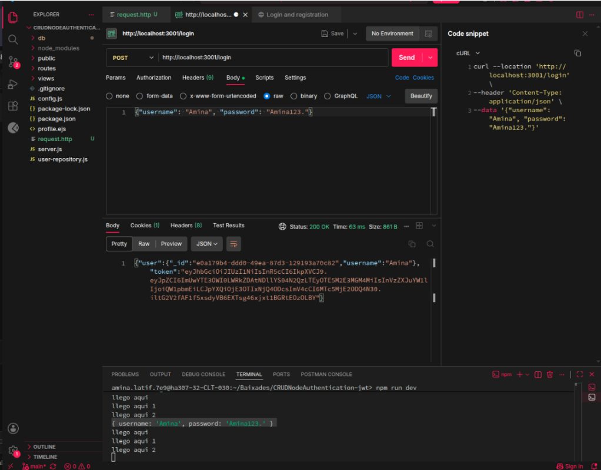
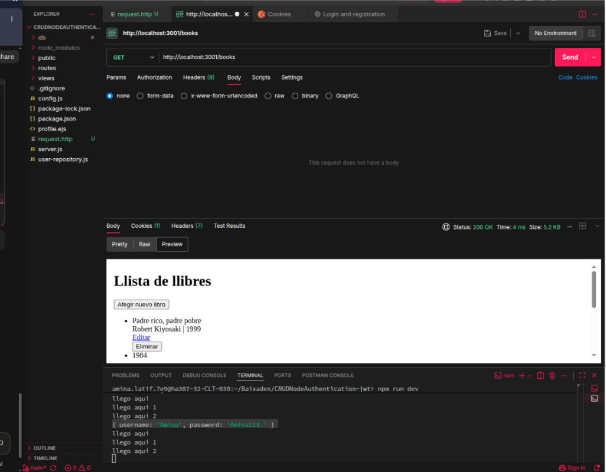
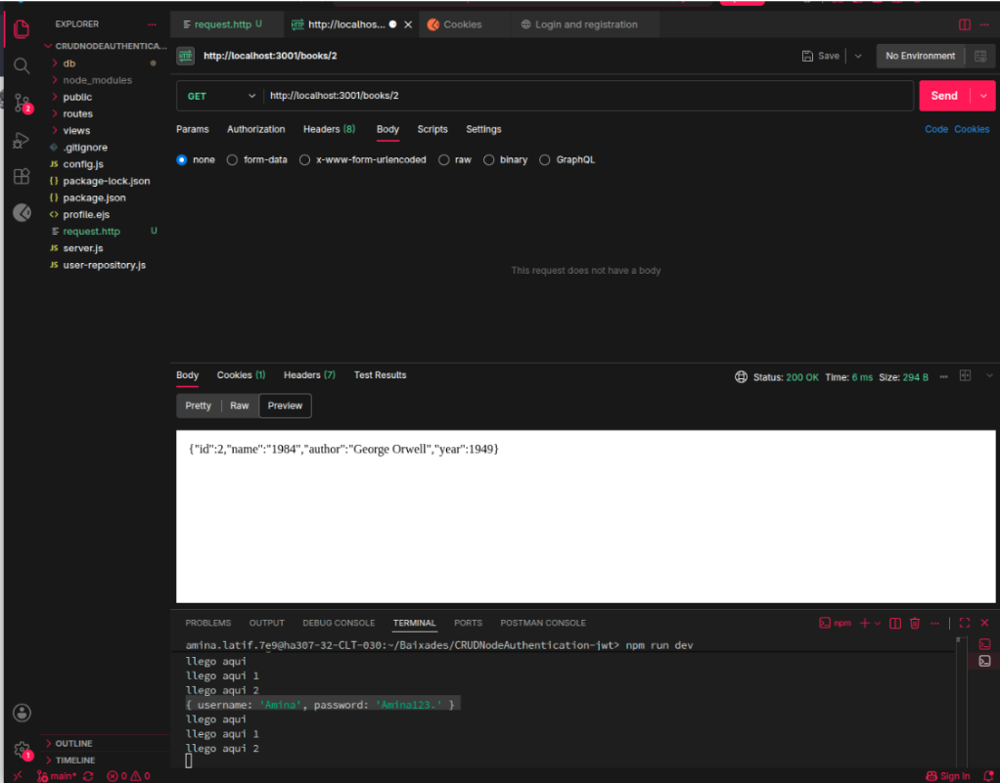
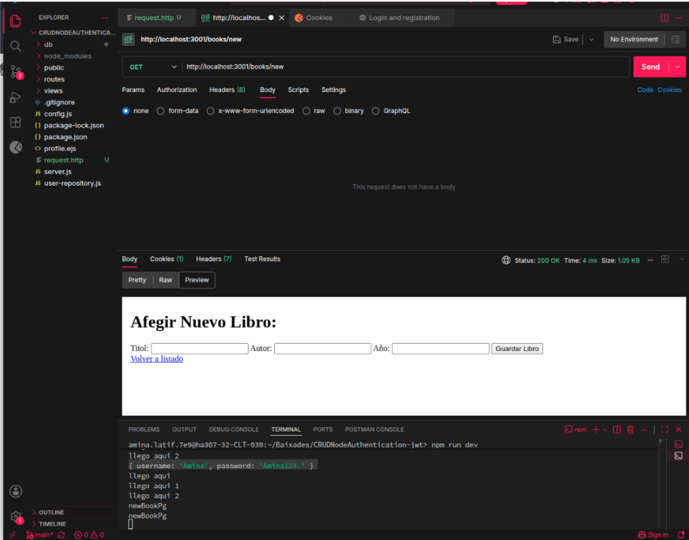
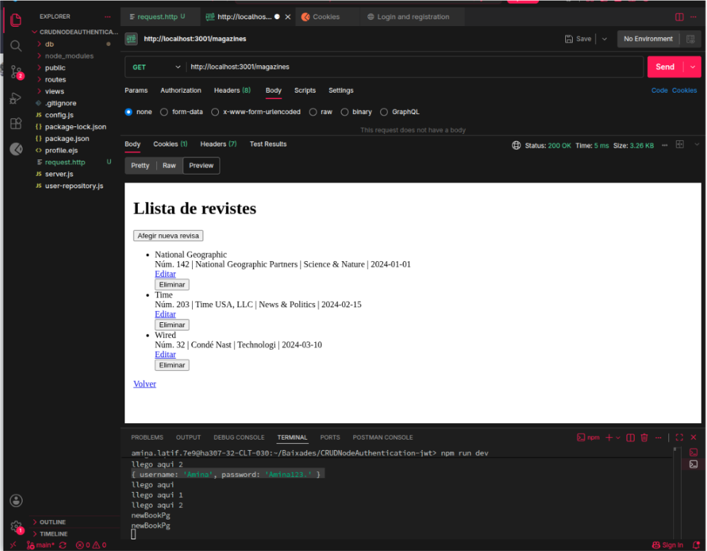
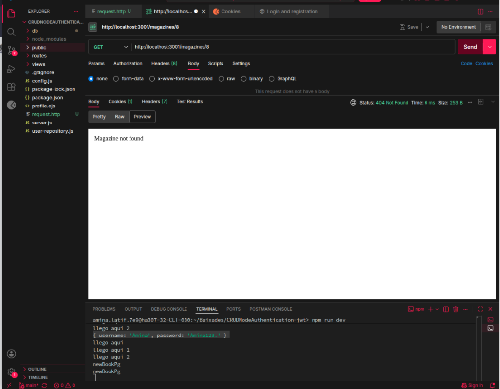
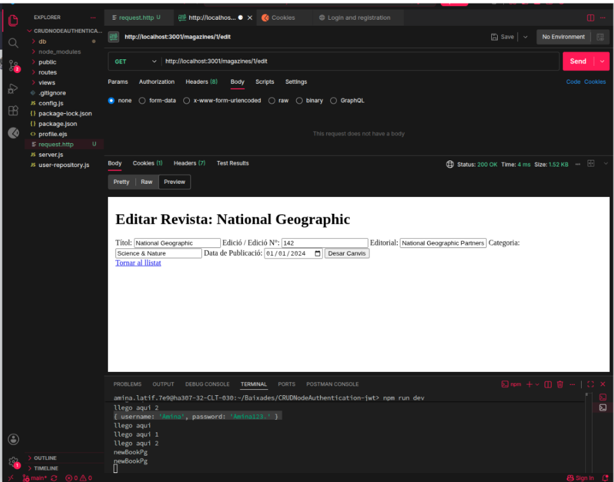

# CRUD Node Authentication (JWT)

A small Node.js + Express app with user login and two CRUD sections (books and magazines).
Users log in with JWT, passwords are hashed with bcrypt, and the views are rendered with EJS.
Data is stored in local JSON files (`db/`).

## Roles

| Role  | List / view | Create | Edit | Delete |
|-------|-------------|--------|------|--------|
| Guest (not logged in) | no | no | no | no |
| user  | yes | yes | yes | no |
| admin | yes | yes | yes | yes |

New accounts are always `user`. An admin is set manually in `db/User.json` (see below).

## Installation

Requires Node.js 18 or newer.

```bash
npm i
npm run dev
```

The server starts on `http://localhost:3001` (change `PORT` in `config.js` if needed).

Set your own `SECRET_JWT_KEY` in `config.js` before using this outside your computer.

## Making an admin

1. Register a normal user from the web page.
2. Stop the server, open `db/User.json`, and add `"role": "admin"` to that user.
3. Start the server again, log out and log in again (the role is stored in the token).

## Pages and endpoints

| Method | Route | Description |
|--------|-------|-------------|
| GET | `/` | Login and register page |
| POST | `/register` | Create a user (`username`, `password`) |
| POST | `/login` | Log in, sets the `access_token` cookie (1 hour) |
| POST | `/logout` | Log out |
| GET | `/protected` | Private page for logged-in users |
| GET | `/books` | List books (HTML) |
| GET | `/books/new` | New book form |
| GET | `/books/:id/edit` | Edit book form |
| GET | `/books/:id` | Get one book (JSON) |
| POST | `/books` | Create a book |
| PUT | `/books/:id` | Update a book |
| DELETE | `/books/:id` | Delete a book (admin only) |
| `/magazines` | same as books | Same CRUD for magazines |

Forms send `POST` with `?_method=PUT` or `?_method=DELETE`; the server turns them into the real verb.

## Endpoint verification

Screenshots of the endpoints tested with REST Client / Postman.

Login page:



List of all books:



Get a book by id:



Create a new book:



List of all magazines:



Get a magazine by id:



Edit a magazine:


